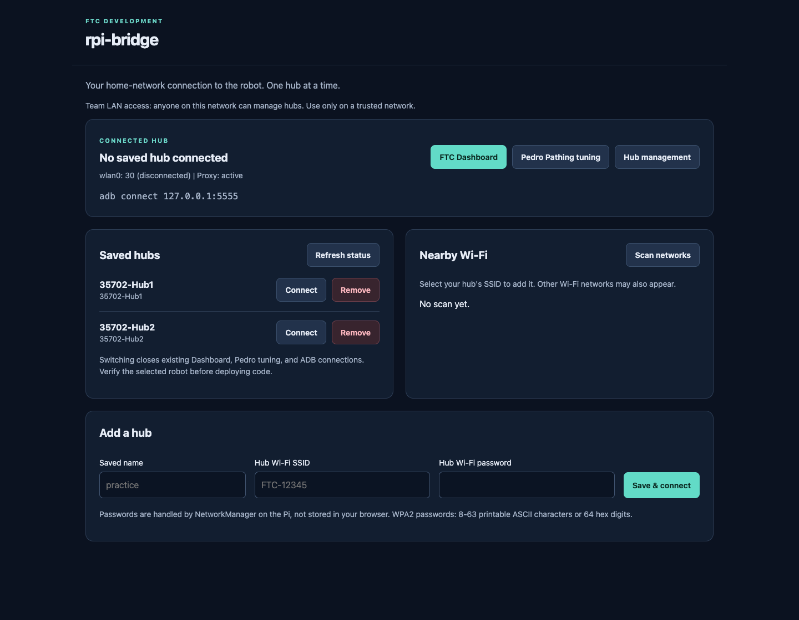

# rpi-bridge

**Connect to your FTC robot without leaving your team's Wi-Fi.**

Usually, connecting your laptop to a Control Hub's Wi-Fi means leaving your
internet connection behind. rpi-bridge uses a Raspberry Pi to connect the two:
your laptop stays on the team network, and the Pi connects to the robot.

```text
Your laptop -- Team Wi-Fi -- Router -- Ethernet cable -- Raspberry Pi
                                                             |
                                                            Wi-Fi
                                                             |
                                                        Control Hub
```

Use a browser to choose a hub, open FTC Dashboard or Pedro Pathing AutoTune,
and connect Android Studio. You can save several hubs, but the Pi connects to
**one hub at a time**.



*The portal on a laptop-sized screen. This local preview shows two saved hubs
with neither connected. On your team's setup, use your Pi's network address,
not the preview's `127.0.0.1` address.*

## Before you start

You will need:

- A Raspberry Pi with Wi-Fi and Ethernet, running Raspberry Pi OS Bookworm or
  newer.
- An Ethernet cable connecting the Pi to your team's router.
- A laptop connected to that same network.
- A powered-on Control Hub and its Wi-Fi name and password.
- Access to a terminal on the Pi, either with a keyboard and monitor or SSH.
  Ask a teammate or mentor if you need help setting this up.

**Use this only on a trusted team network for development, not at competitions.**
There is no login: anyone who can reach the Pi can switch or remove saved hubs.
The website uses HTTP, so Wi-Fi passwords are not encrypted while being sent to
the Pi. Do not expose it to the internet or use router port forwarding.

## 1. Install on the Pi

Open a terminal **on the Raspberry Pi** and run:

```sh
sudo apt update
sudo apt install git python3 network-manager iproute2
git clone https://github.com/DigitalPineapple/rpi-bridge.git
cd rpi-bridge
sudo ./install.sh
```

If `sudo` asks for a password, enter your **Pi user's password**, not the hub's
Wi-Fi password. It is normal for nothing to appear while you type.

The installer starts the bridge and sets it to start automatically when the Pi
boots. It does not connect to a hub yet.

These steps assume the Pi uses the usual network names, `eth0` and `wlan0`.
If installation reports a network error, stop and check the
[technical setup instructions](docs/technical-guide.md#install-on-the-pi)
with a mentor.

## 2. Open the hub manager

Find the Pi's Ethernet address by running this **on the Pi**:

```sh
ip -4 address show dev eth0
```

Look for a line like `inet 192.168.1.50/24`. The address is `192.168.1.50`;
leave off `/24`. Your Pi's address will probably be different.

On **your laptop**, open a browser and enter:

```text
http://YOUR_PI_IP:8090/
```

Replace `YOUR_PI_IP` with the address you found. For example:
`http://192.168.1.50:8090/`.

No login or admin token is needed.

## 3. Connect your Control Hub

1. Click **Scan networks**.
2. Find your hub's Wi-Fi name and click **Add hub**.
3. Enter a saved name, such as `practice`, and the hub's Wi-Fi password.
4. Click **Save & connect** and wait for the hub to appear as connected.

The scan shows nearby Wi-Fi networks, not just robots. Choose your team's hub.
If the password is wrong, the hub stays in **Saved hubs**; click **Connect**
to try again with the correct password.

## 4. Use your robot tools

| What you want to do | How to open it |
|---|---|
| View FTC Dashboard | Click **FTC Dashboard** in the hub manager. |
| Tune Pedro Pathing | Click **Pedro Pathing tuning**. |
| Open the hub's management page | Click **Hub management**. |
| Deploy code from Android Studio | Connect ADB as shown below. |

Dashboard and Pedro Pathing AutoTune must already be installed in your robot
code and running on the hub. The bridge does not install or start them.
The Pedro link is for **AutoTune**, not the separate Pedro Panels app.

For Android Studio, run these **on your laptop** using Android platform-tools:

```sh
adb connect YOUR_PI_IP:5555
adb devices -l
```

Replace `YOUR_PI_IP` with your Pi's address. A result marked `device` means the
robot is ready for ADB; `offline` or `unauthorized` is not ready. Follow your
usual robot setup process if authorization is required.

The hub manager shows the ADB command, but it does not track whether your
laptop is connected.

## Switching and removing hubs

- **Switch robots:** click **Connect** beside another saved hub. Leave its
  password blank to use the saved password.
- **Disconnect:** click **Disconnect** to leave the hub's Wi-Fi without
  forgetting its password. This button hides when no saved hub is connected.
- **Forget a hub:** click **Remove** and confirm. This deletes the saved
  profile and password from the Pi, not from the Control Hub.

**Check the connected hub's name before deploying code or running an OpMode.**
Everyone on the team shares the Pi's selected robot.

Switching hubs, or removing the connected hub, closes its existing connections.
Refresh Dashboard and Pedro tuning, then reconnect ADB on your laptop:

```sh
adb disconnect YOUR_PI_IP:5555
adb connect YOUR_PI_IP:5555
```

## Next practice session

Power up the Pi and the Control Hub. The bridge starts automatically and tries
to reconnect to the last selected hub. If you used **Disconnect**, automatic hub
reconnection stays off until you choose a hub again.

Open the hub manager and check the selected robot. The page updates status
automatically; **Refresh status** checks again immediately. Click **Scan
networks** when you want a fresh list of nearby Wi-Fi networks.

## Updating

Run these **on the Pi**, from the folder you cloned:

```sh
cd ~/rpi-bridge
git pull --ff-only
sudo ./install.sh
```

If you cloned into a different folder, use that location instead. Saved hubs and
settings are kept, but the update closes current robot connections. Refresh the
hub manager afterward.

Older installations may need a small configuration change to enable Pedro
tuning. See [updating an existing installation](docs/technical-guide.md#updating-an-existing-installation).

## Something not working?

| Problem | Try this first |
|---|---|
| Hub manager will not open | Check the Ethernet cable, Pi address, and that your laptop is on the same network. |
| Hub does not appear in the scan | Check hub power and Wi-Fi range, then scan again. |
| Hub will not connect | Check you selected the right Wi-Fi name and entered the hub's password. |
| Dashboard or Pedro tuning will not connect | Check the matching software is running in your robot app. |
| Android Studio cannot see the robot | Run `adb connect YOUR_PI_IP:5555`, then check `adb devices -l`. |
| Page says another operation is running | Wait for your teammate's scan or connection change to finish, then refresh. |

School or guest networks may block devices from talking to each other. Ask your
mentor or network administrator rather than disabling network protections.

For port numbers, custom network settings, service logs, command-line tools,
and deeper troubleshooting, see the **[technical guide](docs/technical-guide.md)**.
